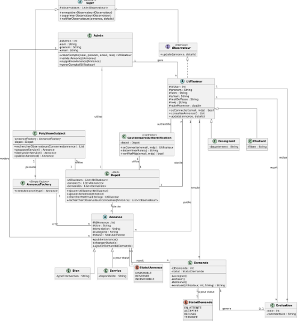

# PolyShare

Plateforme collaborative universitaire permettant aux étudiants et enseignants de partager, prêter et échanger des biens et des services. Elle facilite la mise en relation entre les membres de Polytech Annecy pour répondre à leurs besoins quotidiens. Développé en Java dans le cadre d'un projet de programmation orientée objet (module INFO732).

## Fonctionnalités

- **Comptes** : l'administrateur crée les comptes étudiants et enseignants (pas d'auto-inscription) et peut réinitialiser un mot de passe.
- **Connexion** : vérification de l'email et du mot de passe, puis détermination du rôle.
- **Annonces** : publication de biens (prêt, don…) et de services (tutorat, covoiturage…).
- **Notifications** : à chaque nouvelle annonce, les autres utilisateurs sont prévenus.
- **Demandes** : cycle de vie complet `EN_ATTENTE → ACCEPTEE / REFUSEE → TERMINEE`.
- **Évaluations** : note de 1 à 5 avec commentaire une fois l'échange terminé, avec mise à jour de la note moyenne.
- **Modération** : l'administrateur peut valider ou supprimer une annonce.

## Patrons de conception

| Patron | Classes | Rôle |
|---|---|---|
| Simple Factory | `AnnonceFactory` | Crée un `Bien` ou un `Service` selon le type demandé, sans que l'appelant connaisse la classe concrète. |
| Observateur | `Sujet`, `Observateur`, `PolyShareSubject` | Notifie les utilisateurs concernés lorsqu'une annonce est publiée. `Utilisateur` implémente `Observateur`. |
| DAO | `Depot` | Centralise le stockage des utilisateurs, annonces et demandes. |
| Contrôleur | `GestionnaireAuthentification` | Orchestre la connexion : recherche dans le dépôt, vérification du mot de passe, rôle. |

## Organisation du code

```
Implementation/src/
├── modele/       Utilisateur, Etudiant, Enseignant, Admin, Annonce, Bien, Service,
│                 Demande, Evaluation, StatutAnnonce, StatutDemande
├── dao/          Depot
├── patrons/      AnnonceFactory, Sujet, Observateur, PolyShareSubject
├── controleur/   GestionnaireAuthentification
├── main/         Main (scénario de démonstration)
└── tests/        TestsPolyShare (tests automatiques)
```

## Lancer le projet

**Avec IntelliJ IDEA** : ouvrir le dossier `Implementation`, puis faire un clic droit sur `src/main/Main.java` et choisir **Run 'Main.main()'**.

**En ligne de commande** (Java 17 ou plus), depuis le dossier `Implementation` :

```bash
javac -encoding UTF-8 -d out src/*/*.java
java -cp out main.Main
```

### Scénario de démonstration

Le `Main` déroule cinq étapes :

1. L'administrateur crée les comptes.
2. Connexion réussie, mauvais mot de passe, email inconnu.
3. Publication d'un service, d'une demande de service et d'un bien, avec notifications.
4. Demande, acceptation, fin de l'échange et évaluation (avec les cas refusés).
5. Modération : suppression d'une annonce et réinitialisation d'un mot de passe.

## Tests

`TestsPolyShare` vérifie automatiquement les règles métier (32 vérifications) : création des comptes, connexion, Factory, notifications, cycle de vie des demandes et règles d'évaluation. Ils n'utilisent aucune bibliothèque externe.

```bash
java -cp out tests.TestsPolyShare
# === Tests PolyShare : 32/32 reussis ===
```

## Diagrammes UML

| Diagramme | Fichier |
|---|---|
| Cas d'utilisation | [cas-utilisation.png](docs/diagrammes/cas-utilisation.png) |
| Classes | [diagramme-classes.png](docs/diagrammes/diagramme-classes.png) |
| Séquence : authentification | [sequence-authentification.png](docs/diagrammes/sequence-authentification.png) |
| Séquence : création d'annonce (Factory) | [sequence-creation-annonce.png](docs/diagrammes/sequence-creation-annonce.png) |
| Séquence : notification (Observateur) | [sequence-notification.png](docs/diagrammes/sequence-notification.png) |



## Équipe

Ahlam En-nesyry · Hiba Sebban · Sara Bouarafa · Salma Aittarga
